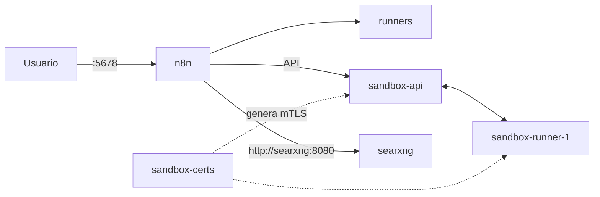

# n8n self-hosted con Docker Compose

[English](README.md) | **Español**

Stack de [n8n](https://n8n.io) autocontenido sobre Docker Compose. Incluye el
servicio de sandbox, task runners y una instancia interna de
[SearXNG](https://docs.searxng.org/) para búsquedas web desde nodos de IA.

## Contenido del stack

| Servicio | Imagen | Función |
| --- | --- | --- |
| `n8n` | `n8nio/n8n` | Aplicación principal. Único puerto publicado al host (`5678`). |
| `runners` | `n8n-io/runners` | Ejecuta el código de los nodos Code. |
| `sandbox-api` | `n8n-io/n8n-sandbox-service-api` | API del servicio de sandbox. Solo accesible por la red interna. |
| `sandbox-runner-1` | `n8n-io/n8n-sandbox-service-runner-dind` | Runner del sandbox (Docker-in-Docker privilegiado). No exponer. |
| `sandbox-certs` | `n8n-io/n8n-sandbox-service-api` | Genera los certificados mTLS y termina. |
| `searxng` | `searxng/searxng` | Motor de búsqueda interno para n8n. No exponer. |

Flujo simplificado:



## Requisitos

- Docker Engine 24 o superior con Compose v2 (`docker compose`).
- 4 GB de RAM como mínimo (se recomiendan 8 GB si se usan sandbox y runners).
- Acceso a `docker.io` y `ghcr.io` para descargar las imágenes.

## Inicio rápido

```bash
git clone https://github.com/brascoo/n8n.git
cd n8n

# Crea tu configuración local a partir de la plantilla
cp .env.example .env
$EDITOR .env

docker compose up -d
```

Comprueba el estado de los servicios:

```bash
docker compose ps
docker compose logs -f n8n
```

Abre n8n en <http://localhost:5678> y crea la cuenta de propietario en el
primer acceso.

> El arranque puede tardar: `sandbox-certs` debe terminar y `sandbox-api`
> debe pasar su healthcheck antes de que arranque `n8n`.

## Configuración

La configuración se carga desde `.env` (creado a partir de `.env.example`),
que es leído por `n8n`, `sandbox-api`, `sandbox-runner-1` y `searxng`.

| Variable | Descripción |
| --- | --- |
| `N8N_VERSION` | Versión de la imagen de n8n (ver [releases](https://github.com/n8n-io/n8n/releases)). |
| `N8N_SANDBOX_VERSION` | Versión del sandbox. La API, el runner y la imagen sandbox comparten release. |
| `N8N_RUNNERS_AUTH_TOKEN` | Token de autenticación entre n8n y los task runners. |
| `SANDBOX_API_KEYS` | Claves aceptadas por la API del sandbox (separadas por comas si hay varias). |
| `SANDBOX_API_RUNNER_REGISTRATION_TOKEN` | Token de registro de runners en el sandbox. |
| `SANDBOX_RUNNER_API_KEYS` | Claves aceptadas por el runner del sandbox. |
| `N8N_SANDBOX_SERVICE_API_KEY` | Clave con la que n8n se autentica en el sandbox. Debe coincidir con uno de los valores de `SANDBOX_API_KEYS`. |
| `SEARXNG_SECRET` | Secreto de la instancia SearXNG. |
| `N8N_INSTANCE_AI_SEARXNG_URL` | URL interna de SearXNG. Debe ser `http://searxng:8080`. |

Genera secretos aleatorios con:

```bash
openssl rand -hex 32
```

No reutilices el mismo valor para todos los secretos y no subas valores reales
al repositorio.

## Operación

```bash
# Ver estado y logs
docker compose ps
docker compose logs -f --tail=100

# Reiniciar un servicio
docker compose restart n8n

# Detener el stack (conserva los volúmenes)
docker compose down

# Detener y borrar datos (¡destructivo!)
docker compose down -v
```

### Actualizar n8n

1. Cambia `N8N_VERSION` (y, si corresponde, `N8N_SANDBOX_VERSION`) en `.env`.
2. Descarga las imágenes y recrea los contenedores:

```bash
docker compose pull
docker compose up -d
```

### Copias de seguridad

Los datos de n8n viven en el volumen `n8n-data`. Para respaldarlo:

```bash
docker run --rm \
  -v n8n-data:/data:ro \
  -v "$PWD":/backup \
  alpine tar czf "/backup/n8n-data-$(date +%F).tar.gz" -C /data .
```

Para restaurar, detén el stack y extrae el archivo en el volumen antes de
volver a arrancar. Verifica siempre la restauración en un entorno de prueba.

## Seguridad

- Solo el puerto `5678` está publicado. `sandbox-api`, `sandbox-runner-1`,
  `runners` y `searxng` deben permanecer en la red interna de Compose.
- `sandbox-runner-1` corre en modo privilegiado (Docker-in-Docker): no
  publiques sus puertos ni lo expongas a Internet.
- Si vas a exponer n8n en un servidor público, ponlo detrás de un reverse proxy
  con HTTPS y configura `N8N_HOST`, `N8N_PROTOCOL` y `WEBHOOK_URL` en
  consecuencia.
- `.env` contiene secretos reales y está excluido del repositorio mediante
  `.gitignore`. Versiona únicamente `.env.example` con valores de ejemplo.
  Si en algún momento se subieron secretos reales, rótalos: siguen presentes en
  el historial de Git.

## Estructura del repositorio

```text
.
├── docker-compose.yaml      # Definición del stack
├── .env                     # Versiones y secretos locales (ignorado por Git)
├── .env.example             # Plantilla de configuración
├── .gitignore               # Excluye secretos y artefactos locales
├── searxng-settings.yml     # Configuración de SearXNG (JSON habilitado)
├── README.es.md             # Documentación en español
└── README.md                # Documentación en inglés
```

## Solución de problemas

- **`n8n` no arranca**: revisa que `sandbox-api` esté `healthy` con
  `docker compose ps`. `n8n` depende de su healthcheck.
- **Puerto 5678 ocupado**: cambia el mapeo en `docker-compose.yaml` o detén el
  proceso que lo usa.
- **Los runners no ejecutan código**: verifica que
  `N8N_RUNNERS_AUTH_TOKEN` coincida entre `n8n` y `runners`.
- **Búsquedas de IA sin resultados**: confirma que
  `N8N_INSTANCE_AI_SEARXNG_URL=http://searxng:8080` y que
  `searxng-settings.yml` mantiene el formato `json` habilitado.
