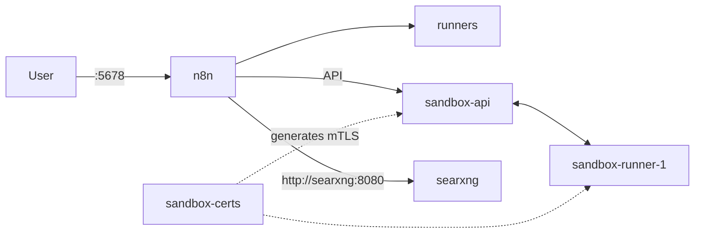

# n8n self-hosted with Docker Compose

**English** | [Español](README.es.md)

A self-contained [n8n](https://n8n.io) stack on Docker Compose. It includes the
sandbox service, task runners, and an internal
[SearXNG](https://docs.searxng.org/) instance for web searches from AI nodes.

## Stack contents

| Service | Image | Purpose |
| --- | --- | --- |
| `n8n` | `n8nio/n8n` | Main application. The only port published to the host (`5678`). |
| `runners` | `n8n-io/runners` | Executes code from Code nodes. |
| `sandbox-api` | `n8n-io/n8n-sandbox-service-api` | Sandbox service API. Only reachable over the internal network. |
| `sandbox-runner-1` | `n8n-io/n8n-sandbox-service-runner-dind` | Sandbox runner (privileged Docker-in-Docker). Do not expose. |
| `sandbox-certs` | `n8n-io/n8n-sandbox-service-api` | Generates the mTLS certificates and exits. |
| `searxng` | `searxng/searxng` | Internal search engine for n8n. Do not expose. |

Simplified flow:



## Requirements

- Docker Engine 24 or newer with Compose v2 (`docker compose`).
- At least 4 GB of RAM (8 GB recommended when using the sandbox and runners).
- Access to `docker.io` and `ghcr.io` to pull the images.

## Quick start

```bash
git clone https://github.com/brascoo/n8n.git
cd n8n

# Create your local configuration from the template
cp .env.example .env
$EDITOR .env

docker compose up -d
```

Check the status of the services:

```bash
docker compose ps
docker compose logs -f n8n
```

Open n8n at <http://localhost:5678> and create the owner account on first
access.

> Startup may take a while: `sandbox-certs` must finish and `sandbox-api` must
> pass its healthcheck before `n8n` starts.

## Configuration

Configuration is loaded from `.env` (created from `.env.example`), which is
read by `n8n`, `sandbox-api`, `sandbox-runner-1`, and `searxng`.

| Variable | Description |
| --- | --- |
| `N8N_VERSION` | n8n image version (see [releases](https://github.com/n8n-io/n8n/releases)). |
| `N8N_SANDBOX_VERSION` | Sandbox version. The API, runner, and sandbox images share one release. |
| `N8N_RUNNERS_AUTH_TOKEN` | Authentication token between n8n and the task runners. |
| `SANDBOX_API_KEYS` | Keys accepted by the sandbox API (comma-separated if there are several). |
| `SANDBOX_API_RUNNER_REGISTRATION_TOKEN` | Runner registration token for the sandbox. |
| `SANDBOX_RUNNER_API_KEYS` | Keys accepted by the sandbox runner. |
| `N8N_SANDBOX_SERVICE_API_KEY` | Key n8n uses to authenticate to the sandbox. Must match one of the values in `SANDBOX_API_KEYS`. |
| `SEARXNG_SECRET` | Secret for the SearXNG instance. |
| `N8N_INSTANCE_AI_SEARXNG_URL` | Internal SearXNG URL. Must be `http://searxng:8080`. |

Generate random secrets with:

```bash
openssl rand -hex 32
```

Do not reuse the same value for every secret, and never commit real values to
the repository.

## Operations

```bash
# Check status and logs
docker compose ps
docker compose logs -f --tail=100

# Restart a service
docker compose restart n8n

# Stop the stack (keeps the volumes)
docker compose down

# Stop and delete data (destructive!)
docker compose down -v
```

### Updating n8n

1. Change `N8N_VERSION` (and `N8N_SANDBOX_VERSION` if needed) in `.env`.
2. Pull the images and recreate the containers:

```bash
docker compose pull
docker compose up -d
```

### Backups

n8n data lives in the `n8n-data` volume. To back it up:

```bash
docker run --rm \
  -v n8n-data:/data:ro \
  -v "$PWD":/backup \
  alpine tar czf "/backup/n8n-data-$(date +%F).tar.gz" -C /data .
```

To restore, stop the stack and extract the archive into the volume before
starting it again. Always verify the restore in a test environment.

## Security

- Only port `5678` is published. `sandbox-api`, `sandbox-runner-1`, `runners`,
  and `searxng` must stay on the internal Compose network.
- `sandbox-runner-1` runs in privileged mode (Docker-in-Docker): do not publish
  its ports or expose it to the Internet.
- If you expose n8n on a public server, put it behind an HTTPS reverse proxy and
  set `N8N_HOST`, `N8N_PROTOCOL`, and `WEBHOOK_URL` accordingly.
- `.env` contains real secrets and is excluded from the repository via
  `.gitignore`. Only version `.env.example` with example values. If real
  secrets were ever committed, rotate them: they remain in the Git history.

## Repository structure

```text
.
├── docker-compose.yaml      # Stack definition
├── .env                     # Versions and local secrets (ignored by Git)
├── .env.example             # Configuration template
├── .gitignore               # Excludes secrets and local artifacts
├── searxng-settings.yml     # SearXNG configuration (JSON enabled)
├── README.es.md             # Spanish documentation
└── README.md                # English documentation
```

## Troubleshooting

- **`n8n` does not start**: check that `sandbox-api` is `healthy` with
  `docker compose ps`. `n8n` depends on its healthcheck.
- **Port 5678 is already in use**: change the mapping in `docker-compose.yaml`
  or stop the process using it.
- **Runners do not execute code**: verify that `N8N_RUNNERS_AUTH_TOKEN` matches
  between `n8n` and `runners`.
- **AI searches return no results**: confirm that
  `N8N_INSTANCE_AI_SEARXNG_URL=http://searxng:8080` and that
  `searxng-settings.yml` keeps the `json` format enabled.
